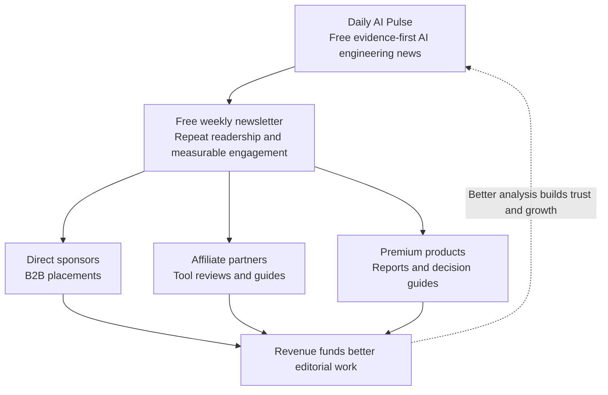

# Daily AI Pulse — Monetization Strategy

**Date:** 12 October 2026  
**Project:** [Daily AI Pulse](https://github.com/GadDev/daily-ai-pulse)  
**Publication:** [The Daily AI Pulse](https://daily-ai-pulse-db253.web.app/)  
**Status:** Strategic exploration — no implementation or automation activated

> **Core recommendation:** Build a small, independent AI media business rather than simply adding advertising to the website. Keep daily articles free, grow an engaged weekly-newsletter audience, and test sponsorships, affiliate partnerships, and premium technical intelligence.

Daily AI Pulse has several realistic monetization opportunities. Given the publication's current structure, the three strongest revenue streams to explore are:

1. **Sponsorships:** AI companies, developer-tool vendors, and startups pay to reach a well-defined technical audience.
2. **Premium intelligence:** Readers pay for deeper analysis, curated technical insights, or practical AI engineering resources.
3. **Affiliate partnerships:** Earn commissions when readers purchase relevant tools you recommend.

Donations, digital products, and, eventually, job listings can complement these revenue streams.

---

## 1. Monetization options compared

| Revenue model | Revenue potential | Initial effort | Priority |
| --- | --- | --- | --- |
| Direct sponsorships | High | Medium | 1 |
| Affiliate partnerships | Medium | Low | 2 |
| Paid research / reports | High | Medium | 3 |
| Donations / memberships | Low–medium | Low | 4 |
| Premium newsletter | Medium–high | Medium | 5 |
| Display advertising | Traffic-dependent | Low–medium | 6 |
| AI job board | Medium | High | Later |
| API / data licensing | Potentially high | High | Later |

**Important:** These are qualitative assessments of business models, *not* estimates of revenue that Daily AI Pulse will generate. Actual results depend on audience size, engagement, credibility, and conversion.

## 2. How each model could work

### A. Direct sponsorships — strongest commercial opportunity

Imagine a company building an AI coding assistant, an LLM observability platform, or a developer framework. Its customers overlap closely with the engineers Daily AI Pulse wants to reach.

You could sell placements including:

- A clearly labeled newsletter sponsor slot.
- A small, non-disruptive homepage sponsor placement.
- A separately labeled sponsored technical article, subject to editorial policies.

**Illustrative placement (not an actual advertiser):**

> **ADVERTISEMENT — Sponsored placement**
>
> **Build better AI agents**  
> Discover developer tooling for testing, tracing, and evaluating production AI applications.  
> **Explore the platform →**

For initial experiments, a fixed-price package around **€100–€250** could be a starting test. This is a *hypothetical opening price*, not a validated market valuation. Audience figures and proof of engagement are needed before promising advertisers results.

**Editorial boundary:** Keep commercial placements completely separate from editorial story selection. Daily AI Pulse's [editorial principles](https://github.com/GadDev/daily-ai-pulse/blob/main/docs/EDITORIAL.md) already support this distinction.

### B. Affiliate marketing — easy to experiment with

A reader discovers a useful development tool through a technical review. They follow a disclosed affiliate link, buy the product, and you receive a commission under the relevant partner program's terms.

Promising categories for Pulse include:

- AI coding and developer productivity tools.
- LLM monitoring, tracing, and evaluation services.
- Cloud and AI developer infrastructure.
- Developer education, technical training, and engineering books.

Examples of genuinely useful editorial formats:

- *AI Coding Agents Compared*
- *My AI Engineering Toolkit*
- *Deploying Your First RAG Application*

The rule is simple: **Earn commissions from credible, original evaluations, not from turning every news article into a sales pitch.** Affiliate eligibility, commissions, and terms must be checked program by program.

### C. Paid intelligence — where differentiation lives

The publication already structures stories by category, signal, evidence strength, difficulty, and sources. That could support a more useful paid product than a generic AI-news digest.

#### Product concept: Pulse Intelligence

*From AI announcements to engineering decisions.*

| | Free edition | Pro edition — illustrative pricing |
| --- | --- | --- |
| **Price** | €0 | €9/month |
| **Content** | Daily news, source links, weekly recap, RSS | Engineering implications, benchmarks, decision guides, practical examples |
| **Goal** | Establish an engaged readership | Deliver reusable engineering value beyond news summaries |

Before launching a subscription, test a **one-time paid engineering report**. For example:

> **The AI Coding-Agent Ecosystem — Engineering Field Guide**  
> An illustrative **€19** report covering architecture comparisons, limitations, practical recommendations, and implementation considerations.

A one-time report tests willingness to pay **without immediately creating a weekly premium-content obligation**.

### D. Reader support — simplest first revenue experiment

External links to creator-support providers can be integrated without a payment backend.

| Provider | Cost model to verify before launch | Suitable use |
| --- | --- | --- |
| [Ko-fi](https://ko-fi.com/) | No monthly fee; Free mode generally advertises 0% platform fee on one-time tips, plus payment-processing charges | Casual reader tips and support |
| [GitHub Sponsors](https://github.com/sponsors) | Personal-account sponsorships generally have no platform fee, subject to eligibility and applicable payment arrangements | Developer-oriented supporters |
| [Buy Me a Coffee](https://www.buymeacoffee.com/) | Typically a 5% platform fee plus payment-processing and any applicable charges | Simple creator-support page |

For a developer-oriented readership, investigate **GitHub Sponsors first**, then Ko-fi for casual readers.

> Provider eligibility, pricing, payment-processing fees, and availability may change. Verify them against each provider's current official documentation before relying on these figures.

### E. Display advertising — probably not yet

Traditional display advertising generally requires substantial traffic to create meaningful revenue.

As an illustration, a **$1.20–$2.30 CPM** would produce approximately **$12–$23 from 10,000 paid impressions**. That is purely a calculation from the assumed CPM, *not* an earnings forecast, and real earnings depend on eligibility, geography, fill rates, network fees, and audience characteristics.

Platforms to evaluate later:

- [Carbon Ads](https://www.carbonads.net/) — developer-focused advertising; network acceptance and available inventory are not guaranteed.
- [Google AdSense](https://adsense.google.com/) — requires site approval and compliance with advertising and content policies.

**Recommendation:** Preserve the site's clean editorial aesthetic and avoid display ads until measured traffic justifies them.

## 3. What the current repository reveals

The review covered the default branch of [GadDev/daily-ai-pulse](https://github.com/GadDev/daily-ai-pulse), including the product requirements, editorial guide, content schema, homepage, subscribe page, layout, privacy page, and content licensing.

### Existing strengths

**Structured publication.** The content collections, sources, evidence classifications, and category metadata can support generated weekly reports, comparisons, and other information products.

- [Product requirements](https://github.com/GadDev/daily-ai-pulse/blob/main/docs/PRD.md)
- [Content model](https://github.com/GadDev/daily-ai-pulse/blob/main/docs/CONTENT_MODEL.md)
- [Astro content schema](https://github.com/GadDev/daily-ai-pulse/blob/main/src/content.config.ts)

**No payment backend required initially.** Astro and Firebase Hosting can display sponsor placements, affiliate disclosures, and links to hosted checkout pages. Solutions such as [Stripe Payment Links](https://stripe.com/payments/payment-links) can provide hosted payment checkout without a custom payments API.

**Strong editorial positioning.** The publication's emphasis on source quality, engineering implications, and separation of facts from commentary is a potential commercial differentiator.

### Gaps to address

**Email subscriptions are not live.** The [Subscribe page](https://github.com/GadDev/daily-ai-pulse/blob/main/src/pages/subscribe/index.astro) currently offers RSS and explicitly describes email delivery as planned. Launch the free Friday newsletter before introducing a premium newsletter tier.

**Reader analytics are missing.** The [Privacy page](https://github.com/GadDev/daily-ai-pulse/blob/main/src/pages/privacy/index.astro) states that the site has no publication analytics tracker. Therefore, current unique visitors, repeat readership, and conversion rates could not be established from the inspected code.

> Selling sponsorships without audience information is like selling advertising in a stadium without knowing how many people attend the matches.

**The implementation opportunity:** Both gaps can be addressed without abandoning the static-first Astro architecture.

## 4. Proposed business model

The central idea is a reinforcing loop: **credible free reporting → recurring reader relationships → relevant commercial products → funding for higher-quality editorial work**.

A free daily publication remains the main acquisition engine. The newsletter establishes a repeat relationship with readers. Monetization then comes from three *distinct* value propositions: access to the audience (sponsors), useful product recommendations (affiliates), and deeper technical work (premium reports).

## 5. Practical 90-day roadmap

| Period | Main objective | Deliverables |
| --- | --- | --- |
| **Days 1–30** | Measure and build audience | Privacy-conscious analytics; free newsletter; reader-support link |
| **Days 31–60** | Test commercial interest | Advertise page; sponsorship media kit; one or two detailed reviews with clearly disclosed affiliate support |
| **Days 61–90** | Validate paid demand | One paid technical report; founding-sponsor outreach; conversion review |

### Metrics worth tracking

- Unique visitors and returning readers.
- Weekly newsletter subscribers and subscriber growth.
- Newsletter engagement and click-throughs.
- Sponsor inquiries and closed placements.
- Affiliate clicks and attributable conversions.
- Paid-report landing-page conversions and net revenue.
- Effort required to publish and maintain each revenue product.

The first milestone is **evidence that a specific group of developers finds the publication useful enough to return regularly**.

### Lightweight payment infrastructure

- **Stripe Payment Links:** Hosted checkout for paid products without creating a custom payments API. Confirm seller eligibility, tax responsibilities, and the actual fee schedule.
- **Gumroad:** A digital-product storefront without a required monthly software subscription. Its previously referenced direct-sale pricing was 10% + $0.50, with additional conditions/charges depending on the transaction; verify current terms before launch.
- **GitHub Sponsors / Ko-fi:** Reader support without implementing accounts or payment storage on Pulse.

### Luxembourg and EU considerations

Because the project is operated from Luxembourg, verify the legal and fiscal requirements before undertaking recurring commercial activity. Luxembourg's [Guichet.lu](https://guichet.public.lu/) explains business permits and related obligations, with requirements depending on the precise nature of the activity.

In addition:

- Clearly label sponsorships and disclose affiliate relationships in accordance with applicable EU consumer-protection rules.
- Keep advertising influence separate from editorial selection and evidence ratings.
- Verify VAT, invoices, and the merchant-of-record or seller obligations for paid digital products.
- Respect privacy and consent requirements when introducing analytics and email signups.
- Keep the **EU-only storage requirement for newsletter subscriber data** distinct from any payment processor's storage and processing arrangements; these are separate data flows.

This is strategic guidance, not legal or tax advice.

## 6. The decision to make now

**Recommended direction:** Keep all daily Pulse articles free, build the weekly newsletter, and make **direct sponsorships the primary long-term commercial model**. Use reader support and one carefully scoped paid report as low-risk ways to test willingness to pay.

**Do not build yet:**

- A full paywall or user-account system.
- A custom payment API.
- A complicated premium subscription platform.
- A job board.
- An API/data licensing product without demonstrated buyer demand.

The strategic choice is between two businesses:

| Direction | Description | Tradeoff |
| --- | --- | --- |
| **Profitable technical publication** | Free AI engineering coverage supported by relevant sponsors, affiliates, and occasional paid reports | Lower operational burden, but dependent on trust and a reachable audience |
| **Broader AI engineering knowledge business** | Publication plus research products, workshops, educational material, and eventually technical tools | Higher potential ceiling, but a different and substantially larger time commitment |

**Current recommendation:** Start with the publication model, validate demand, and expand only when the evidence supports it.

---

## 7. Implementation references

### Daily AI Pulse repository

- [Repository and README](https://github.com/GadDev/daily-ai-pulse)
- [Product Requirements Document](https://github.com/GadDev/daily-ai-pulse/blob/main/docs/PRD.md)
- [Editorial Guide](https://github.com/GadDev/daily-ai-pulse/blob/main/docs/EDITORIAL.md)
- [Content Model](https://github.com/GadDev/daily-ai-pulse/blob/main/docs/CONTENT_MODEL.md)
- [Astro Content Schema](https://github.com/GadDev/daily-ai-pulse/blob/main/src/content.config.ts)
- [Current Subscribe Page](https://github.com/GadDev/daily-ai-pulse/blob/main/src/pages/subscribe/index.astro)
- [Current Privacy Page](https://github.com/GadDev/daily-ai-pulse/blob/main/src/pages/privacy/index.astro)
- [Content Licensing](https://github.com/GadDev/daily-ai-pulse/blob/main/CONTENT_LICENSE.md)

### External services and policy references

- [GitHub Sponsors](https://github.com/sponsors)
- [Ko-fi](https://ko-fi.com/)
- [Buy Me a Coffee](https://www.buymeacoffee.com/)
- [Carbon Ads](https://www.carbonads.net/)
- [Google AdSense](https://adsense.google.com/)
- [Stripe Payment Links](https://stripe.com/payments/payment-links)
- [Gumroad](https://gumroad.com/)
- [Luxembourg Guichet.lu](https://guichet.public.lu/)
- [European Commission — Consumer protection](https://commission.europa.eu/live-work-travel-eu/consumer-rights-and-complaints_en)

> **Verification note:** Pricing, eligibility, taxation, and advertising-network requirements change. Example prices and revenue ranges in this document are illustrative, and external provider terms should be verified directly before implementation.