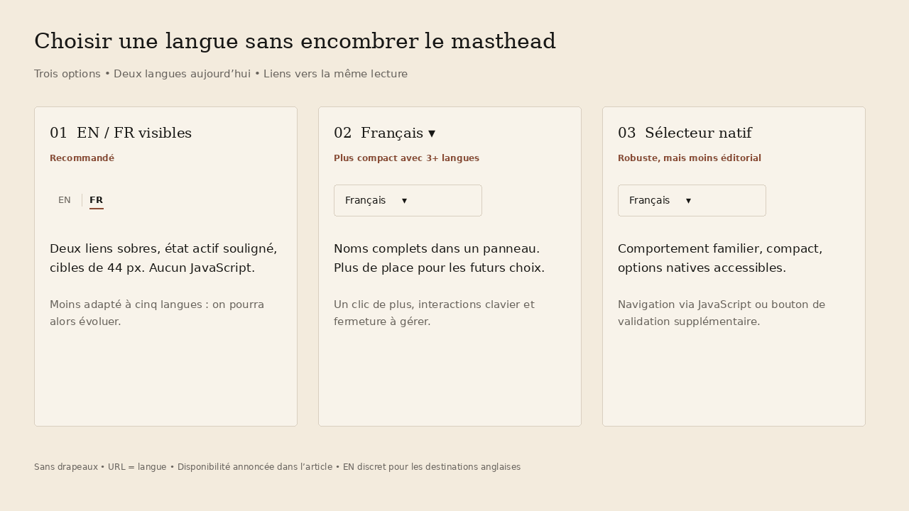
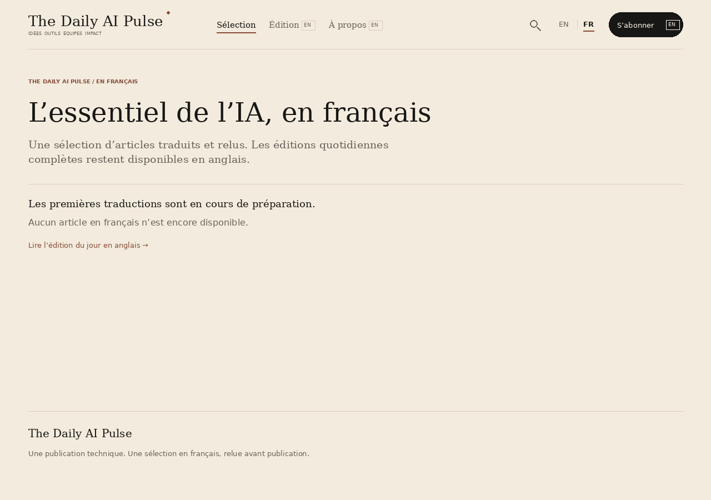
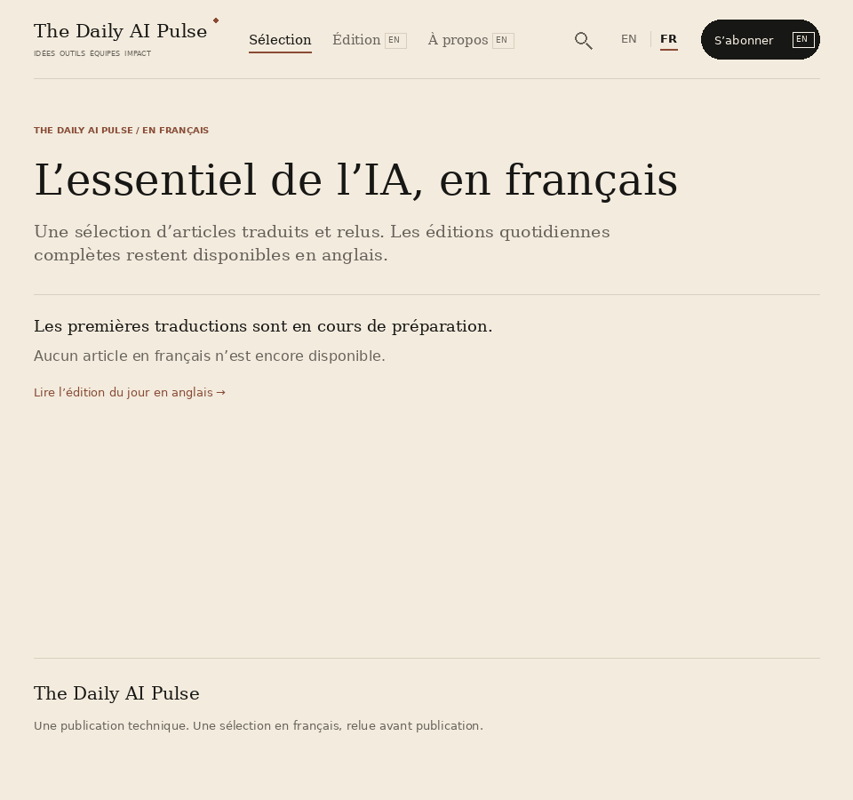
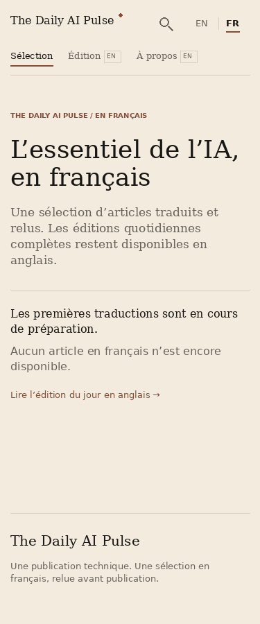
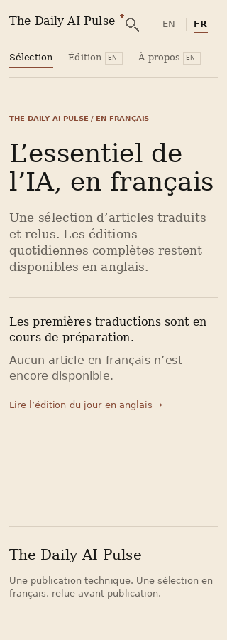
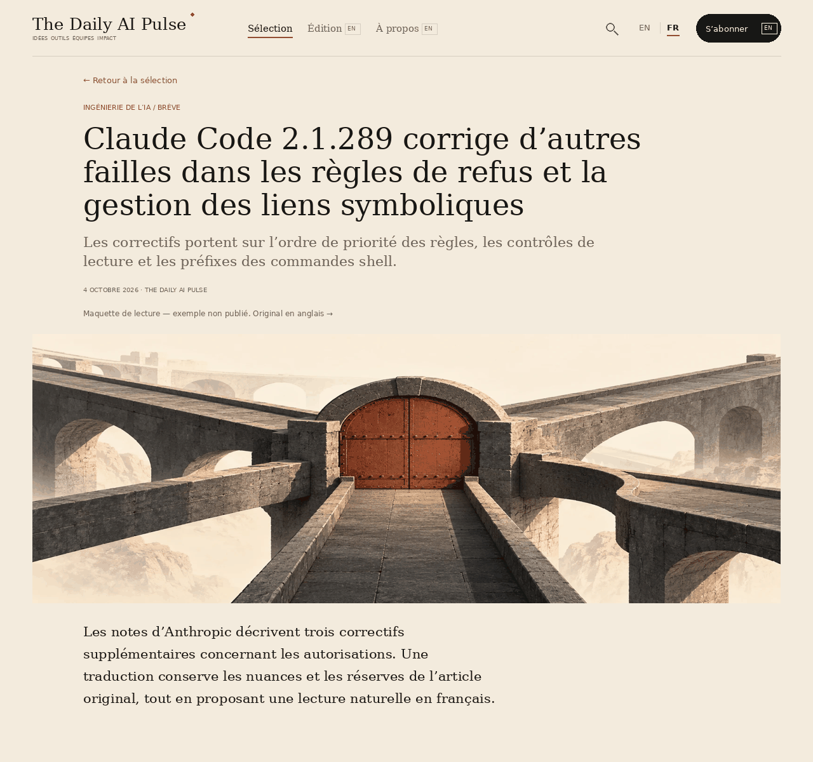
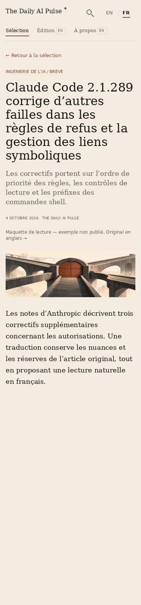

# French reading UX — design before implementation

Reference designs for PR #158, created 14 October 2026. These PNGs are drawn
layout proposals, not browser screenshots or publication approval. The reading
example uses the existing unpublished pilot as a typography/length sample;
the production French selection remains empty until editorial approval.

## Language switcher brainstorm

| Option | Strength | Cost | Decision |
| --- | --- | --- | --- |
| Visible EN / FR link pair | Both choices visible; native link keyboard behavior; no JavaScript; 44px targets | Full names belong in accessible labels; becomes crowded with more locales | Selected for two-language MVP |
| Current-language disclosure | Compact when three or more languages exist; native names can be displayed | Extra interaction and open/close/focus behavior to test | Revisit when adding languages |
| Native select | Familiar accessible control; scales to several options | Navigation needs scripting or an extra submit action; less editorial styling | Viable alternative, deferred |

No flags, automatic browser-language redirect, or false same-story link. Use
English and Français as accessible link names; EN/FR are compact visible labels.
Keep the current state visible. On an English article lacking current French
copy, FR is a non-interactive unavailable state; explain availability beside the
article and provide a distinct link to the French selection. Other page types
may link to that curated selection without claiming equivalence.

## French selection — empty release state

## Reading example — typography stress case, unpublished

## Implementation decisions

- Put language links inside the header action area; remove the full-width row.
- Preserve the publication wordmark and reading typography. Reserve flexible
  space for translated text rather than shrinking it until it fits.
- At 960px and above: one masthead row, all primary nav links on one text line.
- Below 860px: two masthead rows maximum: wordmark/actions, then primary nav.
  Search remains icon-only and the subscription link remains in the footer.
- Use short visible French nav labels (Sélection, Édition, À propos), retaining
  complete destination descriptions in accessible labels. Give English-only
  destinations a restrained EN badge plus screen-reader language description.
- Keep article availability messages in article content, outside navigation.
- Allow long titles/decks to wrap naturally; keep code independently scrollable.
- Validate headers and labels on English and French at 1280, 960, 375 and 320px:
  header height, row placement, nav item line count, target sizes and overflow.
- Capture browser PNGs in CI and check layout, keyboard operation and axe;
  drawn proposals alone cannot establish final implementation quality.

Initial guardrails: masthead height <=90px at desktop widths and <=112px on
mobile; native language links >=44px in both dimensions. Screens show layout
intent rather than font-identical targets (the proposal uses available DejaVu
fonts; production retains its current Georgia/system font stack).

M4's prior overflow-only evidence does not prove this new header geometry.
Update acceptance evidence after the UX changes pass their additional tests.

## Reference-aligned refinement

Reviewed all fourteen images in `docs/reference-layouts/images` on main and
read their companion README. Home, story and component images were inspected
at full size; the other page types were compared together. Local image bytes
were verified against main's Git blob IDs before inspection.

The references prioritize a magazine masthead, serif hierarchy, thin rules,
quiet metadata and one dominant dark subscription action. The first rounded,
dark EN / FR treatment competed with that action. This revision retains two
native language links and their 44px targets, but uses a fine divider, text
weight and terracotta underline for the current language. It is a reading
preference rather than a second primary call to action. The PNGs now reflect
this quieter treatment.

The reference images are generated visual concepts, not factual content or
pixel-perfect screenshots. Their companion HTML/CSS and documentation define
the layout constraints. Long French copy still wraps naturally; no text from
those concept images is promoted into published articles. The empty release
state and unpublished reading samples keep their existing editorial boundaries.
