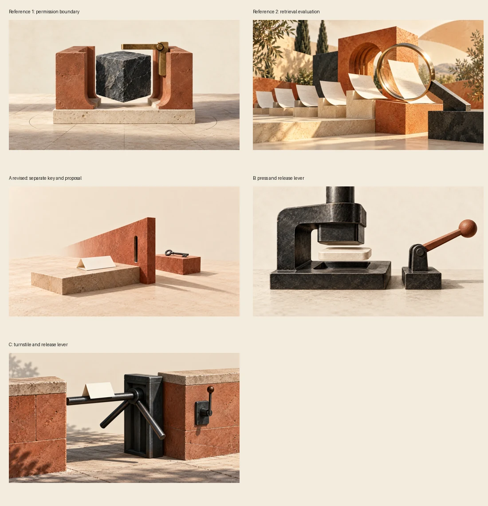
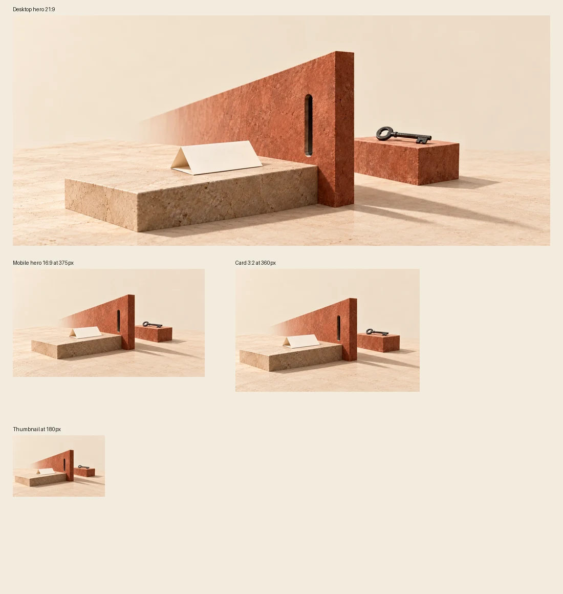

# Agent tool approval boundary — artwork recovery

Date: 23 October 2026. Existing draft: PR #223, `content/tools-guides-2026-10-23`.

This is an assistant visual review of guide artwork, not human editorial approval, a real security mechanism, or acceptance by the news-only Generation Identity validator. The guide remains draft and unpublished. No named reviewer or approval date was fabricated.

## Brief and provenance

The article teaches application-side validation and approval bound to an exact tool proposal. Its local example records fictional notices in memory. The artwork uses a blank folded proposal before a terracotta partition, with the key held separately on the far side. It conveys independent control without claiming a deployed authorization service or solved prompt injection.

Generation used the built-in `image_gen.imagegen`, three distinct candidate compositions and one framing revision of A. Full prompts and actual output identifiers are in [the provenance record](agent-tool-approval-boundary-artwork.json). The tool did not expose a model snapshot; none is claimed. No paid API fallback was used.

Layout inputs: `docs/reference-layouts/story.html`, its `app.js`/`styles.css`, `src/pages/guides/[...id].astro`, `src/styles/article.css` and `GuideCard.astro`. Current guide hero uses centered `object-fit: cover`, 21:9 desktop and 16:9 mobile; cards use 3:2.

## Constitution and candidate comparison

All three compositions were inspected before scoring. No text, numbers, logos, UI, chart, robot, neon, border or frame is visible. They use substantial stone/metal/paper forms, controlled depth and one physical metaphor rather than a technical diagram.

Two production references were inspected directly: `agentic-development-environments-compared.webp` and `rag-retrieval-evaluation.webp`. The first establishes tactile permission-boundary sculpture; the second establishes warm architectural forms and paper materiality. The selected image belongs to that family without copying either composition.

Scores below are subjective assistant visual judgments, not measurements. Columns follow the Illustration System weights: story 20%, brand 15%, composition 15%, crop 15%, meaning 10%, cleanliness 5%, references 20%.

| Candidate | Story | Brand | Composition | Crop | Meaning | Cleanliness | References | Weighted |
| --- | ---: | ---: | ---: | ---: | ---: | ---: | ---: | ---: |
| A revised — separate key | 92 | 92 | 90 | 91 | 88 | 95 | 92 | 91.35 |
| B — press and lever | 84 | 88 | 84 | 76 | 81 | 94 | 85 | 84.00 |
| C — turnstile | 88 | 88 | 84 | 81 | 87 | 94 | 87 | 86.35 |

Selected A revised. B is too close to a product object and crops its upper press; C has more visual machinery and weaker small-scale hierarchy. A's first version placed the key near the card crop edge, so a real image-generation edit pulled the assembly back before acceptance. A exceeds total 85/reference 80 thresholds.

## Crop and binary review

The final WebP was decoded with Pillow after quality-88/method-6 encoding, at 1672×941, 116,048 bytes. The unmarked paper, partition slit and key remain visible in simulated desktop 21:9, mobile 16:9, card 3:2 and 180px thumbnail crops. Labels belong only to the review sheet, not the production artwork.

Final path: `public/images/guides/agent-tool-approval-boundary.webp`.

- SHA-256: `b1aac7df6f3206bf9f93317569a14929bd3bded2b47cc75f093528a46e8a519d`
- Git blob SHA: `775d08922d6bd88e83d96f2a4a7bda439138c014`
- Matching guide `image` and descriptive `imageAlt` supplied.

Binary-safe Git blob creation returned matching content-addressed identities for the cover and two review sheets. Branch attachment and post-commit binary read-back are pending. No UTF-8 text-file API is used for WebP.

## Limits and remaining handoff

The original scheduled run did not record which image capability was missing or whether generation was attempted; this recovery does not invent that history. Capability evidence describes this interactive recovery session only.

The repository contact-sheet script could not launch Chromium because its executable was absent. `npx playwright install chromium` then failed with `End of central directory record signature not found.` Review sheets were instead produced with Pillow and inspected using `view_image`. These are actual image/crop observations, not screenshots of the rendered Astro page. Browser rendering, including the existing SVG diagrams, remains unverified locally.

The included Python snippets have not been executed in this artwork-only recovery. Other editorial and human publication gates remain outstanding. Keep `handoff.completion: blocked`, retain this PR and its original dated ledger, and resume the first unfinished check rather than creating a competing guide. Schema 1.0 is retained for compatibility with current main until the separate orchestrator validator update merges; the additive artwork fields use its new contract.
