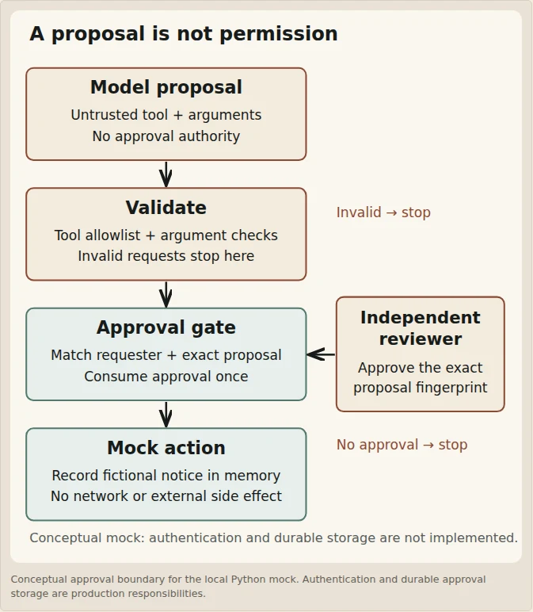
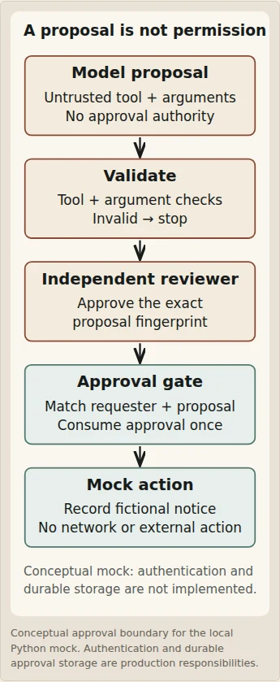
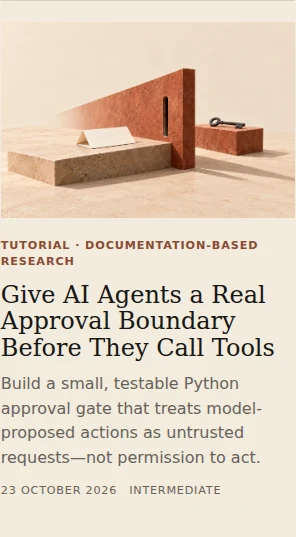

# Agent tool approval boundary — publication preparation

Checked: 23 October 2026. Recovery follows merged PR #223 and orchestrator fix #224.

## Why the guide was missing

Both PRs merged and Firebase deployment succeeded, but the guide on main still had `status: draft`. Its public listing/detail routes deliberately exclude drafts. This publication change supplies `status: published`, the existing house byline `The Daily AI Pulse`, and publication/verification dates. The PR proposes publication; it does not claim human approval or a completed production deployment.

The merged 23 October ledger and prior artwork review remain historical records of the original blocked run. This note supplies later verification evidence without rewriting that immutable history. Code, diagram and image verification below do not establish a secure production agent.

## Exact snippet execution

The two Python fences were extracted unchanged into a disposable directory as `gate.py` and `test_gate.py`, then executed using Python 3.12.14 on Linux:

```text
python --version
Python 3.12.14
python -m unittest -v test_gate.py
Ran 8 tests in 0.001s
OK
```

All eight named tests passed: successful one-time execution, refusal without approval, changed message, mismatched requester, recipient allowlist, unknown tool, separate reviewer and unexpected argument. Six extra isolated checks rejected empty/oversized/non-string messages and a non-string recipient, confirmed a failed requester mismatch does not consume a legitimate approval, and rejected mutation of the proposal dictionary after approval without a log entry.

SHA-256 of each extracted snippet, including one terminal newline:

- `gate.py`: `4348a4282bc897a2c8f296404b86963977da8ccc23140a791904831b8a351e92`
- `test_gate.py`: `8aad9b2c7c8244fe4276c6b7f6b823b84571a70863df54b9e7af3919c0e934a3`

No external API, real notification, authentication, persistent approval storage, concurrent worker or production deployment was exercised. The guide retains `verification: researched` and updates the previously unexecuted-example notes to these observed results. No separate example application or article-specific CI suite is added.

## Source recheck

| Primary source | Claim checked |
| --- | --- |
| [Anthropic tool use](https://platform.claude.com/docs/en/agents-and-tools/tool-use/overview) | Client tools run in the application after a structured model request; server tools are a separate case. |
| [OpenAI function calling](https://developers.openai.com/api/docs/guides/function-calling) | The model returns a call and application-side code executes it. |
| [OWASP Excessive Agency](https://github.com/OWASP/www-project-top-10-for-large-language-model-applications/blob/main/2_0_vulns/LLM06_ExcessiveAgency.md) | Minimize functionality/permissions/autonomy; independently authorize consequential actions. |
| [OWASP prompt-injection prevention](https://cheatsheetseries.owasp.org/cheatsheets/LLM_Prompt_Injection_Prevention_Cheat_Sheet.html) | Validate tool calls against user/session permissions and apply parameter checks and least privilege. |
| [Python secrets](https://docs.python.org/3/library/secrets.html) | `token_urlsafe` supplies a randomly generated token; a token alone does not authenticate the reviewer. |

All five were inspected on the date above. No provider integration or security efficacy benchmark is claimed.

## Real browser verification

The current Chromium download route was unavailable in the earlier recovery. A temporary Playwright 1.55.1 installation succeeded through its Microsoft download mirror, providing Chromium Headless Shell 140.0.7339.186. This browser tooling is outside the repository and does not change project dependencies or CI.

The static Astro build was served through a temporary local HTTP server in the same QA process. At 1280, 960, 375 and 320px:

- The guide detail route returned HTTP 200 with the expected H1, cover and copyable code blocks.
- Desktop SVG loaded above 640px; the mobile variant loaded at 375 and 320px.
- Cover decoded at 1672×941 with the existing meaningful alt text; hero CSS uses 21:9 desktop and 16:9 mobile.
- No document horizontal overflow was observed. Code blocks retain their own scrolling region.
- Axe checks on `main` reported no serious or critical WCAG 2 A/AA or 2.1 A/AA violations. Automated checks do not replace visual review.
- Exactly one guide card appeared on `/guides/`; its image decoded. Sitemap and Pagefind search included the guide. The separate draft sentinel still returned HTTP 404.

Visual inspection found that the original 1100px-wide diagram's text became too small inside the article column. The desktop SVG now uses a narrower vertical sequence with a separate reviewer branch; mobile labels were also enlarged. Both preserve the same code relationships and mock-only limitations. A semantic figure and caption apply the site's existing diagram styling.

The following are real browser screenshots, converted from PNG to WebP with Pillow for storage, not generated mockups:








The existing editorial cover is unchanged; its verified Git blob remains `775d08922d6bd88e83d96f2a4a7bda439138c014`. Its generation prompts, reference comparison and binary read-back remain in the prior artwork review.

## Publication handoff

`npm run verify` passed with the publication state and updated diagrams; the existing guide ledger regression suite also passed. Current-head GitHub CI must be inspected after the PR is created. Human review and merge are still the publication decision. Only after merge and successful Firebase deployment should the production listing and `/guides/agent-tool-approval-boundary/` be described as live.
