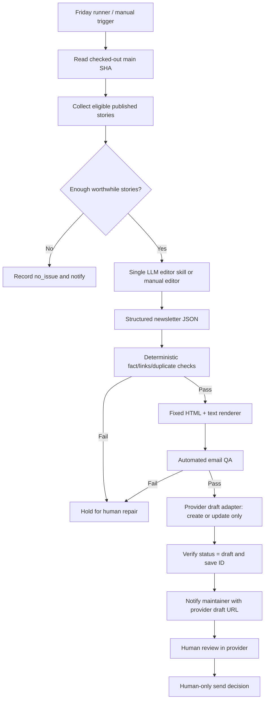

# Daily AI Pulse — Weekly Newsletter Architecture & Tech Stack

**Status:** Design proposal, no code/provider/automation changes performed  
**Date checked:** 2026-10-12  
**Repository:** https://github.com/GadDev/daily-ai-pulse

## Executive decision

Use **existing static Astro publication + deterministic Node.js scripts + one reusable LLM editorial skill + fixed email HTML renderer + managed newsletter provider + human send decision**. No new backend, subscriber database, message queue, or paid email-testing vendor.

**Provider:** Brevo Free is the **conditional lead for fully automated API draft submission** because it documents a campaign-create API that defaults to draft and accepts `htmlContent`, a permanent free plan, and EU database storage. Its free/unverified sender rewrite is explicitly a *temporary* workaround; real free-tier API capability, consent-processing agreements, account approval and delivery behavior still require validation before enabling. MailerLite Free is a credible manual-paste alternative, but its API campaign `content` field is restricted to an Advanced plan despite free GUI HTML editing. EmailOctopus is a strong manual candidate, but its v2 campaign-writing API could not be verified via accessible official docs. If the no-domain workaround becomes unavailable, no fully verified provider meets every mandatory gate; stop and ask whether the sender-domain constraint or automatic API submission may change. **Do not silently switch to a paid plan.**

## Evidence from repository

- `package.json`: Astro `^7.3.8`, TypeScript `6.0.3`, Node `>=22.22.3 <23`; `@astrojs/mdx`, sitemap, Pagefind, ESLint/Prettier, Playwright/axe; no newsletter SDK, MJML, or React Email.
- `astro.config.mjs`: `site: SITE_URL ?? 'https://daily-ai-pulse-db253.web.app'`, base `/`; no server adapter. `docs/ARCHITECTURE.md`: static-generated Firebase Hosting.
- `src/content.config.ts`: `stories` and `pulse` glob collections; stories have `date`, optional `updatedAt`, `draft`, `corrections`, `category`, `evidence`, `signal`, `description`, source links, image info; pulse manifests reference story IDs.
- `src/pages/stories/[...id].astro`: static story routes **filter out `draft: true`**. `src/pages/rss.xml.ts` currently lists `getCollection('stories')` without that filter; therefore the collector MUST NOT treat RSS as a published-only source. `src/pages/subscribe/index.astro` is RSS-only; email is listed on the roadmap. `src/pages/privacy/index.astro` says no email is collected.
- `README.md`, `CLAUDE.md`, `docs/EDITORIAL.md`, `docs/editorial/PR_PREPARATION_V1.md`, `docs/editorial/ledgers/README.md`: ChatGPT scheduled daily news orchestration external to repo; ledgers and PR-preparation/illustration skills; one draft publication PR; human merge before Firebase deployment.
- `.github/workflows/ci.yml` validates PRs; `.github/workflows/deploy.yml` deploys on main and via manual dispatch. There is no verified newsletter production workflow or authenticated newsletter provider account.

### Verified / assumed / proposed

**Verified:** repository architectural facts above, official plan/API/documentation links below. **Assumed:** English-language Friday digest; automated preparation should not use subscriber PII; initial list <=300 for Brevo's one-day free send limit; provider approval possible. **Proposed:** first-run fixed Friday window, newsletter manifest format, Friday runner, provider adapter, human review/notification mechanism. **Unknown:** user account level, email sender address, actual provider permissions/approval, all subprocessor cross-border processing, specific provider MIME plain text behavior, free-tier automated API feature acceptance.

## Provider comparison — mandatory gates (as of 2026-10-12)

| Gate | Brevo Free | MailerLite Free | EmailOctopus Free Starter |
|---|---|---|---|
| €0 ongoing | Yes | Yes | Yes |
| EU subscriber storage | Official docs: France/Germany/Belgium | EU location asserted; specific region undisclosed | AWS Ireland stated |
| Free allowance | 300 email sends **per day**; up to 100,000 stored contacts | 250 active subscribers; 2,500 sends/month | 2,500 subscribers; 10,000 sends/month |
| Free API | Published marketing campaign API; confirm account entitlement | API exists; free HTML write restriction | Legacy API reads campaigns; v2 write unverified |
| API create/update draft | Create defaults to draft; PUT update documented | Draft create/update metadata documented | Unknown (v2 docs not accessible for confirmation) |
| Programmatic inline HTML on free | API accepts `htmlContent`, plan-specific acceptance untested | **No: API docs require Advanced for `emails.*.content`** | Unknown |
| No owned sender domain | **Conditional:** Brevo rewrites sender to `brevosend.com`, warns temporary | Rewrites free senders to `send.mailerlite.eu` | Rewrites to provider-authenticated sender |
| Signup / consent | Hosted/embedded GDPR and double-opt-in forms | Forms/double-opt-in available | Hosted forms/opt-in available; verify consent-export needs |
| Unsubscribe / suppression | Provider footer and unsubscribe controls; suppression under provider | Managed, provider footer | Managed, free rewards link / sender info |
| Brand and port | Free plan branding; contacts export to be tested | Free plan branding; contacts export to be tested | Free rewards link; contacts export to be tested |
| Processing beyond EU | Unknown; EU database/hosting **does not prove every process remains EU-only** | Unknown | UK team and unknown subprocessors; **storage in Ireland**, not EU-only processing |

**Hard gate evaluation:** A provider scoring highly is insufficient. Prior to activation require evidence that (1) the API creates a complete unsent HTML draft in the permanent free account, (2) the sender address works without purchasing a domain, (3) EU-only **storage** covers contacts, backups and relevant datasets, and (4) privacy notices/DPA/consent tools are acceptable. Unknown = fail-to-activate, not tacit pass.

### Weighted fit — only after gates

Scores 0–5 for each category. Weights: API draft automation 30%, EU data/storage confidence 20%, no-domain sender 15%, free-tier capacity 15%, consent/list management 10%, maintenance/portability 10%. Provisional scores: **Brevo 86/100**, **MailerLite 54/100**, **EmailOctopus 63/100**. These are design judgments, **not measured account feature tests**. Manual editorial fallback recommendation: EmailOctopus; all-in-one API-draft target: Brevo conditional.

## Three architecture options

| Option | Design | Strength | Weakness | Trigger to choose |
|---|---|---|---|---|
| A. Manual + skill | Human invokes digest skill, local/repo script makes HTML/text, user copies to provider UI as draft | Simplest verified fallback, no API keys in automation | Friday availability of person, repetitive UI work | Provider API gate fails, or first 1–2 pilot issues |
| B. Scheduled scripts + one LLM step | GitHub Actions script extracts; controlled LLM skill/editor produces JSON; scripts validate/render; provider adapter upserts *draft*; GitHub issue/run summary notifies | Repeatable, single executor and reversible operations | Need actual LLM runtime and account/provider API validation; paid APIs could violate €0 | **Target** after €0 execution and provider tests pass |
| C. Multi-agent | Six autonomous components exchanging artifacts | Specialized review at scale | Overhead, cost, orchestration/approval ambiguity, correlated-model errors | Only if volume, multiple languages, independent sources/tools, and evaluation data justify |

**Zero-budget LLM caveat:** GitHub Actions provides compute but does not include a guaranteed no-cost hosted LLM. A connected ChatGPT skill can draft as a manual step, but its ability to run unattended with shell, repo access and external provider writes is environment-dependent. Do not promise Friday fully unattended operation without proving the orchestration/runtime. Avoid building a custom agent host just to automate one weekly digest.

## Proposed system design

## Trigger, executor, contract, failure and handoff

| Step | Trigger/executor | Inputs | Output/validation | Failure and handoff |
|---|---|---|---|---|
| 1. Schedule | Proposed GitHub Actions `schedule` and `workflow_dispatch` (none activated) | Issue Friday ID, `main` SHA | Unique issue key, local dates; runner allowed only in defined preparation window | Scheduler missed => manual replay same ID; never infer a new range from replay time |
| 2. Collect | Node.js, `fs` + reuse Astro content model (one runtime) | `src/content/stories`, `pulse`, existing feature history | `eligible.json` with published routes, dates, hashes, source links, correction flags | Reject missing/unpublished/withdrawn, fail closed on ambiguous dates |
| 3. Editorial | One controlled skill/model step, human if free unattended runtime absent | Sanitized eligible records; canonical story text only; constitution | Structured `newsletter.json`, selected story IDs, evidence mapping, exclusion reasons | Schema errors/unsupported claims => hold; no model tool authority from source text |
| 4. Validate | Deterministic Node script + human fact spot-check | `newsletter.json`, stored original stories | Check eligibility, duplication, link host/protocol, fact deltas, scores | Block provider submission on critical failures |
| 5. Render | Version-controlled simple HTML template; separate text generator | Validated JSON, URL origin, fixed brand tokens | `email.html`, `email.txt`, subject/preheader | Escape unsafe content, block disallowed URLs or missing compliant footer placeholders |
| 6. QA | Link checker, HTML/static checks, optional Playwright visual preview | HTML/text and live URLs | `qa.json` passes/warnings; screenshots | No claim of Gmail/Outlook rendering from Chromium; block serious issues |
| 7. Draft upsert | Small `fetch` adapter in trusted server-side runner | API key from protected environment, idempotency key, validated HTML | Provider draft ID, verified `status=draft` | Timeout => list/find exact key before retry; never send/schedule |
| 8. Notify | GitHub job summary + optionally one GitHub Issue per weekly key | Non-PII metadata + URL | Draft link, validation state, unresolved warnings | Notification failure visible; draft remains unsent |
| 9. Review/send | Human alone, provider UI | Verified draft and preview | Explicit send/no-send choice; report actual campaign state | Never automate send, recipient list changes, or schedule delivery |

## Weekly collection policy and DST

Use `issue_id = YYYY-MM-DD` of Friday in `Europe/Luxembourg`. Window: `[prior Friday 00:00, issue Friday 00:00)` Luxembourg local civil time. Filter existing **date-only** story metadata on calendar dates, not UTC timestamps. The next planned Friday, **2026-10-16**, uses `2026-10-09` through `2026-10-15` inclusive. Execution-time publication proof comes from merged `main` at pinned SHA, successful deployment where independently verifiable, and edition manifests. Date-only fields cannot prove first-live time: flag late/ambiguous publications and human-approve exceptions.

**Cron proposal:** Friday 08:00 UTC (`0 8 * * 5`), equating to **09:00 CET** in winter and **10:00 CEST** in summer; always Friday local. This honors Friday cadence and DST but **does not run at one fixed Luxembourg wall-clock hour**. A fixed 09:00 Luxembourg clock requires a timezone-aware scheduler or a UTC double-trigger with explicit Luxembourg-time guards and delays covered. For missed runs, `workflow_dispatch(issue_id)` reruns a fixed issue; no backdating claims and no duplicate sends.

## Idempotency, state, traceability

- Canonical idempotency key: `daily-ai-pulse:weekly:YYYY-MM-DD` (no hash in identity). Record source commit SHA and content SHA separately; HTML changes to the same issue update **the same unsent draft**.
- GitHub workflow `concurrency` prevents concurrent scheduled/manual jobs for the same issue on GitHub; provider query confirms exact campaign key/name before create. If multiple matching campaigns, **stop**. Provider campaigns are not assumed to offer atomic uniqueness. Never retry a create blindly after timeout.
- Campaign state machine: `collected -> curated -> validated -> rendered -> submitted_draft -> reviewed_human -> sent_human` or `no_issue/blocked`. Automated code may only enter `submitted_draft` and must read back its actual status. If provider status is `scheduled`, `queued`, or `sent`, automation must not update it.
- Durable audit record (proposed `docs/newsletter/history/YYYY-MM-DD.json`, created in reviewed commits or another durable non-PII location) captures issue ID, included story IDs, local range, commit SHA, template version, content hash, QA, campaign ID/URL and *observed* provider status. A 7-day GitHub Actions artifact alone is not durable editorial memory. If an audit record is absent, mark historical deduplication unverified.
- Do not embed API keys, subscriber lists, email addresses or consent records in Git artifacts, PRs, logs, LLM prompts, or user-visible links containing tokens.

## Technology choices

| Area | MVP recommendation | Rejected/deferred |
|---|---|---|
| Website signup | Provider's hosted or safely embedded form on existing `/subscribe/`; amend `/privacy/` | New Astro endpoint/server, bespoke subscriber table |
| Publication source | Checked-out `main` Markdown/MDX + manifests, checked with repo code | Web scraping; RSS as sole eligibility source (currently omits draft filter) |
| Source parsing | Existing Astro validation semantics; small Node parser if it doesn't diverge | Parallel content schema or crawler |
| Network | Native Node `fetch` with timeout/retries/idempotency | SDK until typed errors/auth or repeated calls justify it |
| Editorial generation | One structured-output skill/model step; manual if €0 unattended inference unavailable | Six agents, repeated independent discovery |
| Templates | Versioned table-based HTML + inline CSS; semantic text; provider footer placeholders | React Email (React runtime), MJML dependency until complexity warrants; browser page HTML |
| Client QA | Static rules + Chromium preview + manual representative inbox tests | Claiming cross-client correctness from Playwright; paid rendering farm |
| Scheduling | Existing GitHub Actions ecosystem (future, no trigger yet) | New Cloud Run / cron backend |
| State | Existing repository, provider campaign ID/status, small manifest | New Postgres/Redis/queue |
| Secrets | GitHub environment/repo secrets and least privilege, protected job | Astro `PUBLIC_*`, browser exposure, checked-in `.env` |
| Notification | Job summary and one tracked issue/link, verified by owner | Silent logs or assumed inbox notifications |

## Realistic QA matrix

| Test | Automation at €0 | Actual client evidence required |
|---|---|---|
| Canonical URLs and HTTPS, redirects, link labels, no accidental unsubscribe-URL rewrite | Scripts / finite network retries | Review destinations manually when a link changes |
| Images, alt text, asset accessibility, explicit width/height | Static checks and HEAD/GET | Gmail proxy/blocking differences; images-off view |
| Contrast and text sizing | Static token checks + browser axe checks | Outlook high-contrast behavior |
| Responsive layout | Chromium at 320/375/600/desktop | Gmail mobile app and iOS Mail inbox |
| Dark mode | Color checks + forced dark browser preview | iOS Mail and Outlook mobile dark mode |
| Supported CSS | Simple table layout; disallow scripts/forms/JS/external CSS | Outlook Windows desktop Word rendering |
| Subject/preheader | Length/nonduplication/string checks | Gmail, Outlook, Apple Mail truncation |
| Plain text | Generate `email.txt`, compare links/story sequence | Verify provider actually sends a multipart text alternative |
| Footer, branding, consent, unsubscribe | Check placeholders and provider API response | Actual provider preview/test email after substitution |

**Manual client matrix:** Gmail web Chrome; Gmail iOS or Android; Outlook web; Outlook Windows desktop where accessible; Apple Mail on macOS/iOS. At €0, only devices/accounts actually owned by the maintainer can be tested; record untested cells as `not tested`. Send a test message only in an explicitly authorized later QA activity; this design review sends none. Provider preview is useful but is not universal rendering certification.

**Draft submission blockers:** wrong eligible story list, unsupported claims, missing link/attribution, unsafe HTML/remote asset, broken canonical link, invalid provider footer, no generated plain text, duplicate issue conflict, wrong sender/recipient configuration, missing API key, provider API uncertainty, or provider returning any status other than `draft`. **Human review required:** editorial quality, disclosure, dark-mode/Outlook screenshots, final subject/preheader, no-domain sender identity, working unsubscribe test and actual recipient targeting.

## Security — design review, not code audit

| Material risk / failure scenario | Mitigation | Residual limitation |
|---|---|---|
| Credential leak via CI or browser | API key only in protected GitHub environment; no `PUBLIC_*`; log redaction; rotate if exposed | Brevo API key scope/granularity must be confirmed |
| Automated subscriber send from wrong API | Adapter allowlist for GET/POST draft and PUT draft; exclude `send`/`schedule` endpoints and permissions if possible; read-back status | Broad provider token may technically allow sending; human process and code review still matter |
| Prompt injection in story or source text | Treat as data only; structured schema output; no model access to provider credentials; deterministic validator | LLM can still invent unsupported claims; review mandatory |
| HTML injection, URL spoofing, remote tracking | Escape/sanitize all interpolated strings; allow HTTPS canonical domains; safe image proxy/host policy; no user-submitted HTML | Email clients rewrite CSS/links; remote images reveal opens |
| Subscriber PII leaks to model/GitHub | Provider-hosted consent and lists; no subscriber data passed to models, stored in repo, or logged | Provider's own support/subprocessor access requires DPA review |
| GDPR data residency assumption | Confirm EU primary and backup storage via official DPA and subprocessor list; document non-EU processing separately | EU data storage != entirely EU processing |
| Double opt-in/suppression failure | Provider-native DOI, suppression and unsubscribe; test opt-out; do not import old lists unconsented | Provider integrations and account settings may differ |
| Dependency or workflow compromise | Pin actions/versions, `npm ci`, minimal GitHub permissions, protect environment, Dependabot updates, PR review | Existing repo workflow dependencies still require audit |
| Partial API failure / duplicate campaigns | Stable issue key, single concurrency group, read-before-write and read-after-write; do not retry blind creates | Provider may lack atomic idempotency; manual resolution for ambiguous duplicates |
| Sender rewrite expires | Treat domain-free provider sender as provisional; deliverability check, re-evaluate before launch | No-domain design may cease to be supported |

## Overlooked decisions

- Public site `/subscribe/` and `/privacy/` must be changed together, before collecting addresses.
- Decide English-only vs multilingual newsletters separately from the site's prospective i18n work.
- Determine legal sender identity, contact postal address/privacy page and measurable consent text; private-address feature may depend on provider.
- Decide audience growth cap: Brevo Free allows only **300 sends per day**. A weekly digest to >300 readers may be split across days; do not promise Friday delivery to all.
- Decide whether to disable open tracking and click tracking; disable until disclosed/consented as applicable.
- Define data subject requests, retention/deletion, support/security incident contacts, and provider exit (CSV export, suppressed contacts, consent logs).
- Sender domain purchase would violate strict €0 recurring unless separately donated/covered; do not assume it.

## Official sources checked

- [Brevo free plans and limits](https://help.brevo.com/hc/en-us/articles/208589409-About-Brevo-s-pricing-plans)
- [Brevo API — create campaign](https://developers.brevo.com/reference/create-email-campaign)
- [Brevo API — update campaign](https://developers.brevo.com/reference/update-email-campaign)
- [Brevo EU database storage](https://help.brevo.com/hc/en-us/articles/360001005510-Data-storage-location)
- [Brevo sender domain workaround and its limitation](https://help.brevo.com/hc/en-us/articles/14925263522578-Comply-with-Gmail-Yahoo-and-Microsoft-s-requirements-for-email-senders)
- [Brevo consent form](https://help.brevo.com/hc/en-us/articles/208771869-Create-a-sign-up-form-in-Brevo)
- [Brevo unsubscribe](https://help.brevo.com/hc/en-us/articles/209553645-Insert-a-custom-unsubscribe-link-in-your-emails)
- [MailerLite June 2026 free plan change](https://www.mailerlite.com/help/free-plan-update-faq)
- [MailerLite campaign API — Advanced HTML restriction](https://developers.mailerlite.com/api/campaigns)
- [MailerLite EU data storage](https://www.mailerlite.com/help/is-my-data-safe-with-mailerlite)
- [MailerLite free sender rewriting](https://www.mailerlite.com/help/the-limitations-of-using-a-free-domain)
- [EmailOctopus pricing](https://emailoctopus.com/pricing)
- [EmailOctopus EU storage](https://help.emailoctopus.com/article/8-data-storage-and-gdpr-compliance)
- [EmailOctopus sender workaround](https://help.emailoctopus.com/article/160-verifying-a-new-domain)
- [EmailOctopus legacy campaign API](https://emailoctopus.com/api-documentation/campaigns) (v2 API write not verified)