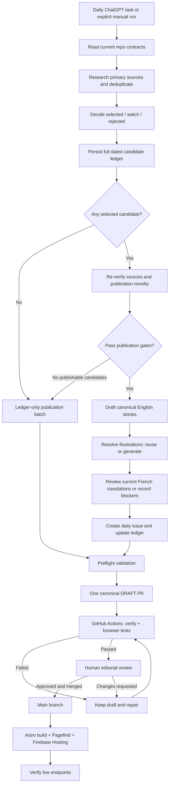

# Daily AI Pulse — Daily News Orchestrator

> **Workflow reference · checked 23 October 2026** against the current `GadDev/daily-ai-pulse` repository contracts, GitHub Actions workflows and ChatGPT scheduled-task configuration. This documents how the **daily news** publication workflow operates; it is not an instruction to trigger a run.

_The diagram is available as an editable [SVG](https://github.com/GadDev/daily-ai-pulse/blob/main/docs/diagrams/daily-ai-pulse-orchestrator.svg). The wiki diagram link becomes live after the companion documentation PR is merged into `main`._

## At a glance

The **ChatGPT Daily AI Pulse Orchestrator** is a separately configured, **enabled daily scheduled task**. It reads the editorial rules from the **current `main` branch**; researches new developments; records both selected and excluded candidates; prepares at most **one human-reviewable draft PR** for the editorial date; and then stops. **Only a person may approve and merge** the PR. A merge to `main` starts the GitHub Actions deployment to **Firebase Hosting**.

There are **three distinct systems**:

- **ChatGPT scheduled task:** starts the editorial run and coordinates the steps. The task configuration is outside the repository.
- **GitHub repository:** owns policies, structured research ledgers, story/issue Markdown, reviewed WebP assets, source-controlled validation and PRs.
- **GitHub Actions + Firebase Hosting:** check PRs; after an approved merge, rebuild and deploy the Astro static site and Pagefind search index.

## Workflow

**Human boundary:** A successful automated run or green CI is **not** publication. The editorial task never merges, enables auto-merge, or marks its draft PR ready for review.

## 1. Research and candidate decisions

1. Load the current version of the [editorial schema](https://github.com/GadDev/daily-ai-pulse/blob/main/docs/editorial/EDITORIAL_SCHEMA_V1.md), [decision engine](https://github.com/GadDev/daily-ai-pulse/blob/main/docs/editorial/DECISION_ENGINE_V1.md), [topics](https://github.com/GadDev/daily-ai-pulse/blob/main/docs/editorial/TOPICS_V1.yml), [PR preparation contract](https://github.com/GadDev/daily-ai-pulse/blob/main/docs/editorial/PR_PREPARATION_V1.md) and linked skills/schema before acting.
2. Research primary sources; distinguish release/event dates from article dates; compare with published coverage and previously committed ledgers to avoid duplicates.
3. Categorize significant candidates as **selected**, **watch**, or **rejected/already covered**, with evidence, scores and deduplication reasons as required by the repository contracts.
4. Persist the complete ledger under `docs/editorial/ledgers/YYYY-MM-DD.json` on the **canonical dated branch** `content/daily-ai-pulse-YYYY-MM-DD`.

**No publishable story?** That is legitimate. Persist the ledger and open a **ledger-only draft PR**. Do not invent a story, daily issue or illustration merely to fill a quota.

The [daily news execution contract](https://github.com/GadDev/daily-ai-pulse/blob/main/docs/editorial/DAILY_NEWS_ORCHESTRATION_V1.md)
defines a bounded search across all eight desks, source/archive evidence and
explicit research completion criteria. Reading contracts is initialization;
unfinished research requires continuing the work. A real blocker identifies an
observed failure, attempted recovery, saved work and the next action.

Research now follows a candidate queue: verify, search prior coverage, classify,
save, then move to the next candidate or desk. Retries consume the saved queue
before repeating discovery. A successful checkpoint write requires its next
action immediately. Structured checkpoint metadata and
`npm run editorial:run:check -- YYYY-MM-DD --handoff` reject an unfinished final
handoff or a blocker without observed failure/recovery evidence. This validates
records; it cannot force scheduler continuation or prove research quality.

Each run checkpoints actual phase progress in
`docs/editorial/runs/YYYY-MM-DD.md` on the same dated branch, including discovery
window, queries, sources, archive coverage and gaps. A partial checkpoint is
never a completed candidate ledger or evidence of a quiet day. A failure for
one candidate does not stop independent work. Retries preserve prior evidence
and resume the existing branch/PR; an already merged batch is not recreated.

## 2. Prepare stories, illustrations, translations and issue

For selected candidates that still pass **publication-time verification** and deduplication:

- Draft the canonical article at `src/content/stories/YYYY-MM-DD-slug.md`. The familiar article structure explains **What changed**, **Why it matters**, the **Evidence boundary**, and the **Engineer takeaway**.
- Use the [illustration system](https://github.com/GadDev/daily-ai-pulse/blob/main/docs/editorial/ILLUSTRATION_SYSTEM_V1.md) and [Visual Constitution](https://github.com/GadDev/daily-ai-pulse/blob/main/docs/editorial/VISUAL_CONSTITUTION_V1.md). The image decision may safely **reuse** an existing asset, require explicit handling of a **legacy** review, or **generate** new candidates. Constitution, comparison/reference fit, scoring, crop review, WebP normalization, hash and review metadata all matter. An illustration is **not** a replacement for source verification.
- Under the [bilingual workflow](https://github.com/GadDev/daily-ai-pulse/blob/main/docs/editorial/translations/DAILY_BILINGUAL_WORKFLOW.md), reuse genuinely current reviewed French material or prepare/review a French version. **Missing, blocked or stale French content must be reported and withheld**, not published as if current. English may still proceed under the repository policy.
- Assemble the daily issue at `src/content/pulse/YYYY-MM-DD.md` and reconcile its story IDs with the **full** ledger. Selected candidates withheld after verification remain recorded as selected **and withheld**, not silently reclassified.

## 3. One draft PR, CI and human approval

- Reuse the existing dated branch/PR if it exists; do not create parallel editorial batches for one date.
- Run available local preflight checks and the repository's standard `npm run verify`; report **not run** where execution was unavailable.
- Open or update **one** draft PR: `content: prepare Daily AI Pulse for YYYY-MM-DD`.
- GitHub Actions [CI](https://github.com/GadDev/daily-ai-pulse/blob/main/.github/workflows/ci.yml) verifies repository/build integrity and browser/accessibility checks. Failed CI remains a **draft** requiring repair.
- An editor assesses factual accuracy, sources, prose, illustration quality, translations and the exact PR CI result before merging.

## 4. Build and deploy

After the human merges to `main`, [the production workflow](https://github.com/GadDev/daily-ai-pulse/blob/main/.github/workflows/deploy.yml) verifies the build, generates the static Astro site and Pagefind index, authenticates through keyless Google Cloud Workload Identity Federation, and deploys to [Firebase Hosting](https://daily-ai-pulse-db253.web.app/). It also checks live Hosting endpoints. **GitHub Pages is legacy**, not the canonical production host.

## Operational ownership and sources of truth

| Concern                                    | Source of truth                                                                                        |
| ------------------------------------------ | ------------------------------------------------------------------------------------------------------ |
| Schedule and trigger                       | ChatGPT **Daily AI Pulse Orchestrator** scheduled task (outside GitHub)                                |
| Evidence, scoring and selections           | `docs/editorial/DECISION_ENGINE_V1.md`, `EDITORIAL_SCHEMA_V1.md`                                       |
| Full decisions, including rejected/watch   | `docs/editorial/ledgers/YYYY-MM-DD.json`                                                               |
| Bounded execution, completion and recovery | `docs/editorial/DAILY_NEWS_ORCHESTRATION_V1.md`; phase evidence in `docs/editorial/runs/YYYY-MM-DD.md` |
| Publication preparation                    | `docs/editorial/PR_PREPARATION_V1.md` and `.agents/skills/daily-ai-pulse-pr-preparation/SKILL.md`      |
| Illustration reuse, integrity and review   | `docs/editorial/ILLUSTRATION_SYSTEM_V1.md` and illustration skill                                      |
| French review and staleness                | `docs/editorial/translations/DAILY_BILINGUAL_WORKFLOW.md`                                              |
| Article and issue source                   | `src/content/stories/` and `src/content/pulse/`                                                        |
| Automated checks                           | `.github/workflows/ci.yml`                                                                             |
| Deployment                                 | `.github/workflows/deploy.yml`, Firebase Hosting                                                       |
| Final editorial approval                   | **Human PR review and merge**                                                                          |

## Separate workflow: Tools & Guides

The **Tools & Guides Editorial Orchestrator** is an **independent scheduled task** running Tuesday and Friday mornings. It writes to `src/content/guides/` and `docs/editorial/tools-and-guides/ledgers/`, uses its own [editorial contract](https://github.com/GadDev/daily-ai-pulse/blob/main/docs/editorial/TOOLS_AND_GUIDES_ORCHESTRATOR_V1.md), prepares at most one **draft guide PR** and cannot publish autonomously. It does **not** reuse the daily news ledger or issue manifest. A guide marked `draft` stays out of public listings even if a draft PR was merged; publication requires explicit editorial authorization.

---

**Maintaining this page:** Review it when the scheduled task, source contracts, illustration rules, translation contract or hosting pipeline changes. **Never infer current state from the images dated 6 October 2026.** Distinguish actual task run state, created branches/PRs, CI status and deployment success when reporting any execution.
